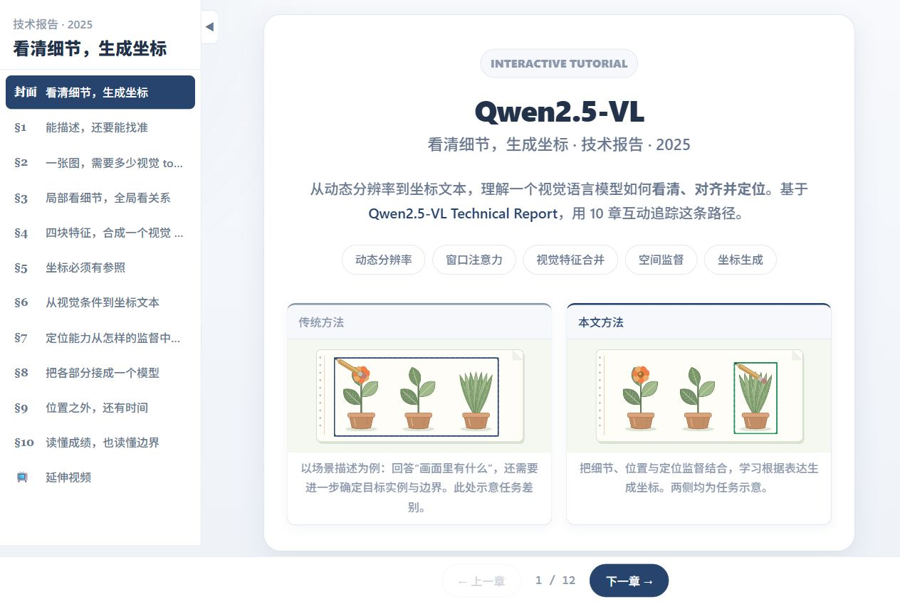

# Qwen2.5-VL：看清细节，生成坐标 交互式教程

基于 [Qwen2.5-VL Technical Report（arXiv:2502.13923v1）](https://arxiv.org/html/2502.13923v1) 的简体中文交互式论文导读，使用 React + TypeScript + Vite。

共 10 章、12 个主动交互模块，沿动态分辨率、视觉编码、特征合并、坐标参照、空间监督到定位评测展开。插画使用统一的植物观察手帐风格。



插画均由本项目用 Canvas 绘制，预览截图来自本项目页面。论文与视频仅提供可追溯的外部链接，不打包论文全文或视频素材。

## 本地运行

```bash
npm install
npm run dev -- --host 127.0.0.1 --port 5176 --strictPort
npm run build     # 产出 dist/ 静态站点
npm run preview   # 预览构建结果
```

开发服务启动后，打开 **http://127.0.0.1:5176/**。不要直接双击源码中的 `index.html`；它需要 Vite 处理 TypeScript。若使用 pnpm，可执行 `pnpm install --frozen-lockfile`，再使用对应的 `pnpm dev`、`pnpm build` 命令。

最终提交应保留整个项目的源码、配置、README 和锁文件，不要只复制 `index.html` 或 `dist/`。`node_modules/` 与 `dist/` 是本地生成内容，已由 `.gitignore` 排除。

## 阅读与核验

- 章节 2、4、8 的形状与数量依据原文 §2.1、表 1；页面公式明确标注为教学推导。
- 章节 5、7 的坐标与监督说明依据 §2.2.1；训练阶段依据 §2.2.2 表 2、§2.3.1、§2.3.4。
- 章节 9 对照 §2.1.2–2.1.3；章节 10 的数值逐项对应 §3.3.3、表 6。
- 插画交互是规则驱动的教学示意，页面不加载模型权重、不产生真实预测。原文基准数据与教学案例明确区分。
- 注意力网格、架构热点与拖框支持键盘操作；系统开启“减少动态效果”时，插画保持静态，交互仍然可用。

## 验证

`npm run build` 先执行 TypeScript 检查，再构建静态网页。交互复查覆盖尺寸滑块、注意力网格、合并步骤、坐标拖动与边界、关系切换、结构化输出、监督类型、训练阶段、架构热点、时间采样与结果对比。

## 目录结构

| 路径 | 说明 | 是否生成器（Agent）修改 |
| ---- | ---- | ---- |
| `src/data/tutorial.ts` | 论文专属内容（章节、模块、公式、B 站、元信息） | ✅ 唯一数据文件 |
| `src/styles/paper.css` | 论文专属配色与必要的布局修正 | ✅ 仅此 CSS |
| `src/modules/*.tsx` + `registry.tsx` | 论文专属 Canvas 交互组件 | ✅ 在 registry 注册 |
| `public/images/*` | 论文原图（可选） | ✅ 仅放图 |
| `src/components/*` | 静态展示组件（Hero/Chapter/Module…） | ❌ 模板框架默认 |
| `src/lib/*` | 静态工具（canvasKit / B 站） | ❌ 模板框架默认 |
| `src/styles/{tokens,components}.css` | 静态设计令牌与组件样式 | ❌ 模板框架默认 |

## 配色语义（contract.md §5，保持稳定）

- `--blue` 指导/当前状态，`--green` 成功/本文方法，`--red` 失败/传统方法
- `--orange` 用户强调，`--purple` 辅助机制

切勿把 `--accent` 重新定义成别的语义角色。
